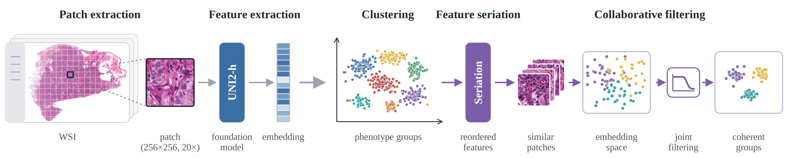
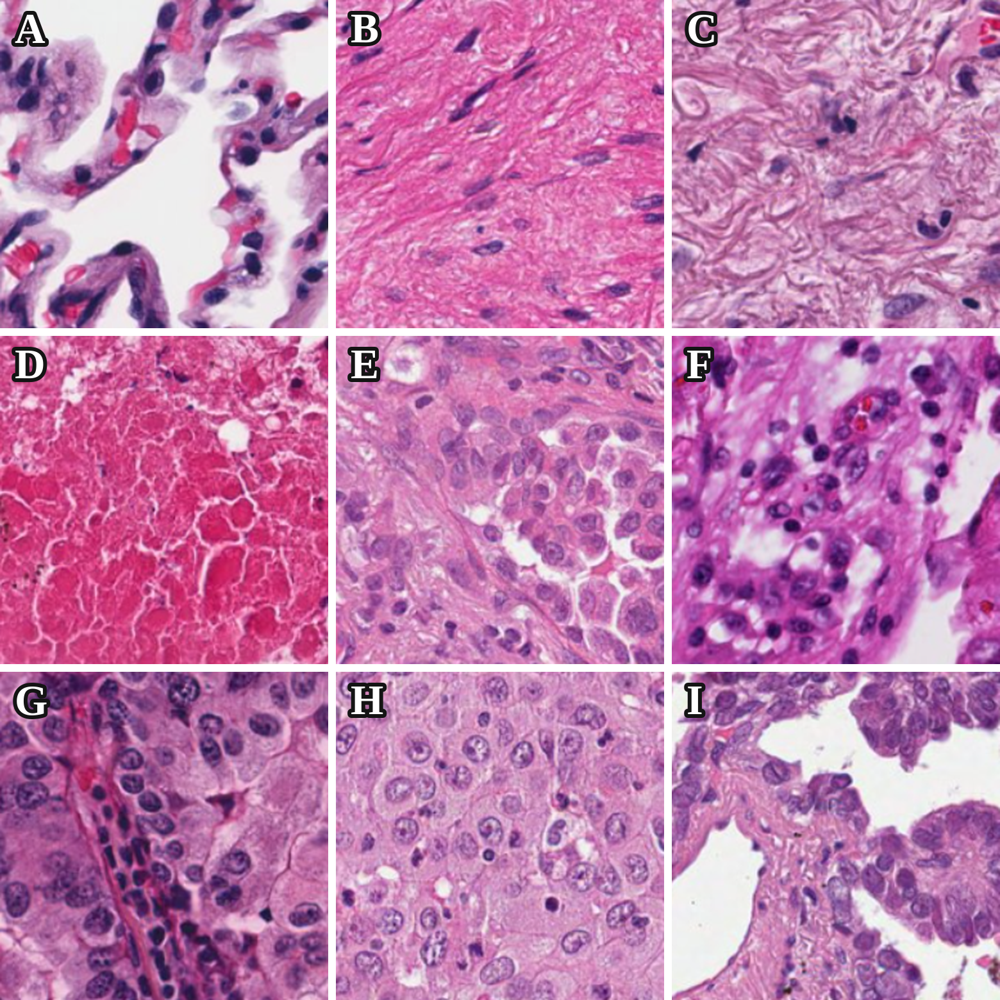
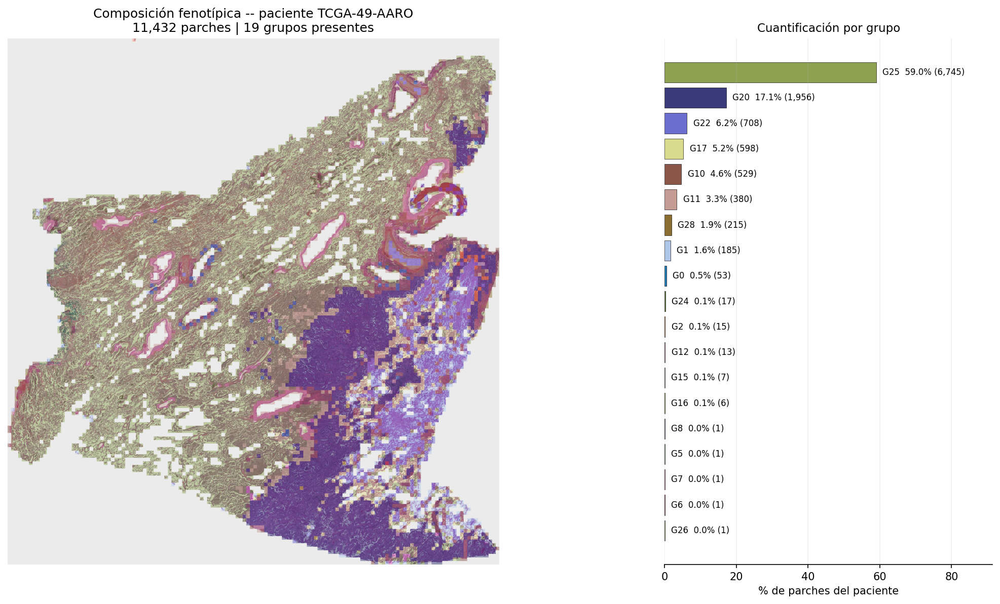

# Collaborative filtering for histological quantification of lung adenocarcinoma

Code to group patch embeddings from TCGA-LUAD whole-slide images and filter them collaboratively within each group.



Patches are extracted from each whole-slide image and embedded with the UNI2-h foundation model. The embeddings are grouped with cosine k-means, their features are reordered by seriation, and each group is filtered jointly so that similar patches share a coherent representation.

## Run order

| Step | Script | Output |
|---|---|---|
| 1 | `scripts/dot.py` | Cosine k-means with 32 global groups (`block_matching_exp2_groups.pkl`) |
| 2 | `scripts/order.py` | Signed seriation of the feature axis (`feature_orders/global.npz`) |
| 3 | `scripts/hybrid.py` | Collaboratively filtered embeddings, Haar on the patch axis and Fourier low-pass on the feature axis (`block_matching_exp2_block2_hybrid_filtered.pkl`) |
| 4 | `scripts/compose.py` | Group composition map of one patient over its real patch mosaic |

Each script reads its input paths from the configuration block at the top of the file. The input is a pickle with one row per patch, the columns `case_id` and `image_path`, and one numeric column per embedding dimension.

## Example results

Representative patches of the nine tissue categories assigned by the pathologist to the groups.



Group composition of patient TCGA-49-AARO generated with `scripts/compose.py`. Each patch of the slide is colored by its group, and the bars show the percentage of patches in each group.



## Requirements

```bash
pip install numpy pandas scipy scikit-learn matplotlib pillow
```
